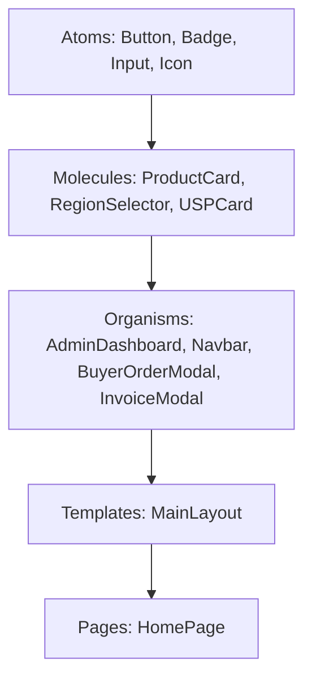

# 🌐 PT. Matrispan Exim Phoenix Corp — Frontend Platform

> **Platform Perdagangan Internasional B2B Ekspor Komoditas Unggulan Indonesia & Portal ERP Eksekutif Terintegrasi**  
> *Hub Logistik & Pengapalan: Pelabuhan Internasional Belawan (IDBLW), Sumatera Utara, Indonesia.*

---

## 📑 Daftar Isi
1. [Tentang Sistem](#-tentang-sistem)
2. [Teknologi & Framework Utama](#-teknologi--framework-utama)
3. [Arsitektur Desain: Atomic Design System](#-arsitektur-desain-atomic-design-system)
4. [Sistem State Management (Modular Svelte Stores)](#-sistem-state-management-modular-svelte-stores)
5. [Fitur Unggulan Sistem](#-fitur-unggulan-sistem)
6. [Struktur Direktori Proyek](#-struktur-direktori-proyek)
7. [Panduan Instalasi & Menjalankan Proyek](#-panduan-instalasi--menjalankan-proyek)
8. [Standar Kualitas Kode (Clean Code & SOLID)](#-standar-kualitas-kode-clean-code--solid)
9. [Integrasi Backend & API](#-integrasi-backend--api)

---

## 🏛 Tentang Sistem

**PT. MATRISPAN EXIM PHOENIX CORP (MEPC)** adalah korporasi ekspor Indonesia yang bergerak dalam perdagangan internasional 4 sektor komoditas strategis:
1. **Rempah-Rempah Tropis (Spices)**: Biji Pala ABCD, Cengkeh Lal Pari, Lada Hitam GL 550, Kayu Manis Kerinci.
2. **Kelapa & Produk Turunan (Coconut Derivatives)**: Kopra Putih Edible, Briket Arang Shisha, Cocopeat Low EC.
3. **Perikanan & Seafood Beku (Frozen Seafood)**: Udang Windu Black Tiger, Ikan Kakap Merah, Tuna Loin Sashimi Grade.
4. **Wastra Nusantara & Kriya (Textiles & Handicrafts)**: Tenun Songket Deli & Sutra Tradisional.

Frontend ini dirancang dengan prinsip **Dual-Facing Architecture**:
- **Sisi Publik (Public Portal)**: Menampilkan etalase komoditas ekspor berstandar internasional, kalkulator harga multi-mata uang (USD / IDR), formulir pemesanan buyer internasional (Incoterms FOB & CIF), dan portal kemitraan suplai petani/pemasok mencakup **38 Provinsi di Indonesia**.
- **Sisi Portal Internal (Executive Admin Portal)**: Dashboard operasional komprehensif untuk direksi dan staf ekspor guna mengelola pesanan masuk, menerbitkan dokumen **Proforma Invoice resmi**, memverifikasi proposal suplai petani, mengelola tiket pertanyaan/inquiry via WhatsApp, serta memantau audit keamanan data secara real-time.

---

## ⚡ Teknologi & Framework Utama

| Komponen | Teknologi | Keterangan & Rationale |
| :--- | :--- | :--- |
| **Framework UI** | [Svelte](https://svelte.dev/) | Reaktivitas berbasis *compiler*, performa render tercepat tanpa *overhead* Virtual DOM |
| **Build Tool & Bundler** | [Vite 8](https://vitejs.dev/) | Server pengembangan instan dengan Hot Module Replacement (HMR) dan build optimal |
| **Styling Engine** | [Tailwind CSS](https://tailwindcss.com/) | Desain responsif berbasis utility-first dengan palet korporat *Forest Green* (`#0B2D24`) & *Imperial Gold* (`#C88A2E`) |
| **Type Safety** | [TypeScript](https://www.typescriptlang.org/) | Pengetikan statis ketat pada DTO pesanan, invoice, komoditas, dan otentikasi |
| **State Management** | Svelte Stores (Writable, Derived) | Reaktivitas data terpusat, sinkron otomatis dengan backend Rust Axum |
| **Pencetakan Dokumen** | CSS Print Media (A4 Standard) | Cetak Proforma Invoice & Laporan Eksekutif presisi tinggi tanpa terpotong di kertas A4 |

---

## 📐 Arsitektur Desain: Atomic Design System

Struktur komponen frontend dibangun menggunakan metodologi **Atomic Design**, membagi hierarki antarmuka menjadi unit terkecil yang independen dan dapat digunakan kembali (*reusable*):



1. **Atoms (`src/lib/components/atoms/`)**:
   - `buttons/`: `GoldButton.svelte`, `PrimaryButton.svelte`, `WhatsAppButton.svelte`
   - `badges/`: `StatusBadge.svelte`, `ExportBadge.svelte`
   - `inputs/`: `InputField.svelte`, `SelectField.svelte`
   - `icons/`: `PhoenixLogo.svelte`, `SpicesIcon.svelte`, `CoconutIcon.svelte`, `SeafoodIcon.svelte`, `TextilesIcon.svelte`
   - `typography/`: `Heading.svelte`

2. **Molecules (`src/lib/components/molecules/`)**:
   - `cards/`: `ProductCard.svelte`, `StatCard.svelte`, `USPCard.svelte`
   - `forms/`: `RegionSelector.svelte` (Cascading dropdown 38 Provinsi dengan live search), `IncotermsSelector.svelte`
   - `modals/`: `SupplierSuccessCard.svelte`
   - `notifications/`: `NotificationToast.svelte`

3. **Organisms (`src/lib/components/organisms/`)**:
   - `header/`: `Navbar.svelte` (Pelacak posisi halaman aktif / *scroll spy* & multi-currency switcher)
   - `hero/`: `HeroSection.svelte`, `USPSection.svelte`
   - `catalog/`: `CommodityShowcase.svelte` (Katalog komoditas dengan filter sektor)
   - `buyer-order/`: `BuyerOrderModal.svelte` (Formulir PO Buyer internasional)
   - `supplier-request/`: `SupplierFormModal.svelte` (Portal kemitraan petani 38 provinsi)
   - `invoice-generator/`: `InvoiceModal.svelte` (Tampilan cetak Proforma Invoice komersial)
   - `admin/`:
     - `header/AdminHeader.svelte` (Identitas staf, status Belawan, status koneksi Axum)
     - `navigation/AdminNavStrip.svelte` (Navigasi tab horizontal multi-menu)
     - `tabs/`: `OverviewTab.svelte`, `OrdersTab.svelte`, `SuppliersTab.svelte`, `MessagesTab.svelte`, `InvoicesTab.svelte`, `CatalogTab.svelte`, `SettingsTab.svelte`
     - `auth/`: `LoginForm.svelte`, `RegisterStaffForm.svelte`, `PasswordStrengthMeter.svelte`
     - `reports/`: `ReportOrdersTable.svelte`, `ReportSuppliersTable.svelte`, `ReportInvoicesTable.svelte`, `ReportSummaryKpi.svelte`, `ReportSignatureBlock.svelte`
     - `modals/`: `OrderDetailModal.svelte`, `MessageReplyModal.svelte`, `ProductEditModal.svelte`
   - `admin-tables/`: `AdminDashboard.svelte` (Orchestrator utama), `AdminLoginModal.svelte`, `AdminReportModal.svelte`

4. **Templates & Pages (`src/lib/components/templates/` & `pages/`)**:
   - `templates/MainLayout/MainLayout.svelte`: Kerangka pembungkus global
   - `pages/HomePage.svelte`: Halaman utama aplikasi

---

## 🔄 Sistem State Management (Modular Svelte Stores)

Semua *state* aplikasi didekomposisi ke dalam modul terisolasi di bawah direktori `src/lib/stores/`:

| File Store | Tanggung Jawab & Data yang Dikelola |
| :--- | :--- |
| `auth.store.ts` | Status login admin, token JWT, profil staf (`currentUser`), dan aksi autentikasi (`login`, `register`, `logout`) |
| `cart.store.ts` | Keranjang pemesanan buyer internasional, kuantitas, catatan kemasan, dan total nilai estimasi |
| `orders.store.ts` | Daftar pesanan buyer, aksi persetujuan pesanan (tombol **OKE & Terbitkan Invoice**), penolakan, dan penyesuaian harga penawaran |
| `suppliers.store.ts` | Antrean proposal kemitraan petani/pemasok, verifikasi kapasitas bulanan, dan integrasi WhatsApp logistik |
| `invoices.store.ts` | Arsip Proforma Invoice resmi bernomor standar MEPC dengan instruksi pembayaran Bank Mandiri USD |
| `messages.store.ts` | Pusat pesan inquiry web dan WhatsApp resmi, pelacakan status (`UNREAD`, `READ`, `REPLIED`) |
| `products.store.ts` | Katalog komoditas ekspor, estimasi harga FOB per MT, HS Code, dan MOQ |
| `security.store.ts` | Jejak log audit aktivitas internal dan hasil laporan pengujian penetrasi keamanan dari NeonDB |
| `ui.store.ts` | Pemilih mata uang global (**USD / IDR** dengan kurs JISDOR), navigasi aktif, kontrol modal, dan sistem notifikasi toast |
| `sync.ts` | Sinkronisasi berkala (polling 8 detik) dengan REST API backend Rust Axum |
| `index.ts` | *Central Hub re-export* bersih (<20 baris) menjaga kompatibilitas impor seluruh aplikasi |

---

## ✨ Fitur Unggulan Sistem

### 1. Multi-Currency Global Switcher (USD & IDR)
Katalog produk dan rekapitulasi transaksi mendukung konversi otomatis antara **US Dollar ($)** untuk pembeli internasional dan **Rupiah (Rp)** berdasarkan kurs acuan Bank Indonesia JISDOR (~Rp 16.250 / USD).

### 2. Cascading Region Selector (38 Provinsi Indonesia)
Mitra petani dan pemasok dapat memilih lokasi gudang/kebun dengan sistem dropdown bertingkat: memilih Provinsi terlebih dahulu yang otomatis menyaring Kabupaten/Kota yang sesuai, dilengkapi fitur pencarian instan (*live search*).

### 3. Generator Proforma Invoice & Ekspor Dokumen Cetak Standar A4
Sistem menghasilkan dokumen invoice ekspor lengkap dengan:
- Kode QR verifikasi kriptografis
- Data perbankan devisa resmi PT. MEPC di Bank Mandiri (USD FX Account & SWIFT Code)
- Penyesuaian CSS Print khusus agar dokumen A4 tidak terpotong pada batas samping (*no margin bleed*).

### 4. Pusat Laporan Eksekutif (Executive PDF Report)
Fitur cetak laporan formal internal pada dashboard admin yang mencakup:
- Rekapitulasi pesanan buyer internasional
- Rekapitulasi kapasitas jaringan suplai mitra tani nasional
- Neraca dokumen komersial invoice ekspor
- Dilengkapi cap dinas resmi PT. MEPC dan stempel tanda tangan direksi.

### 5. Sistem Keamanan Berbasis NIK & RBAC
Portal admin diamankan dengan autentikasi berbasis Nomor Induk Karyawan (**NIK** dengan format `MEPC-DIV-XXX`), validasi kekuatan password (*Bcrypt*), dan pembatasan peran (*Role-Based Access Control*):
- `SUPER_ADMIN` (Akses Penuh Direksi)
- `EXPORT_MANAGER` (Manajer Pemasaran & Kontrak Dagang)
- `EXPORT_STAFF` (Staf Operasional Ekspor)
- `LOGISTICS_OFFICER` (Operasional Pelabuhan Belawan)
- `SOURCING_OFFICER` (Kemitraan Suplai Petani)
- `FINANCE_OFFICER` (Keuangan & Devisa Kargo)

---

## 📂 Struktur Direktori Proyek

```
frontend/
├── public/                     # Aset statis publik (logo.webp, favicon.svg, icons.svg)
├── src/
│   ├── assets/                 # Aset gambar & ilustrasi vektor
│   ├── lib/
│   │   ├── api/
│   │   │   └── client.ts       # HTTP Client penghubung API Rust Axum
│   │   ├── components/
│   │   │   ├── atoms/          # Atoms UI (badges, buttons, icons, inputs, typography)
│   │   │   ├── molecules/      # Molecules UI (cards, forms, modals, notifications)
│   │   │   ├── organisms/      # Organisms UI (admin, catalog, hero, header, modals)
│   │   │   ├── templates/      # Templates layout
│   │   │   └── pages/          # Halaman aplikasi
│   │   ├── data/
│   │   │   ├── indonesiaRegions.ts  # Re-export hub wilayah Indonesia
│   │   │   └── regions/        # Data provinsi & kabupaten per kepulauan
│   │   ├── stores/             # Svelte stores terisolasi per domain (<150 baris per file)
│   │   ├── types/              # Deklarasi antarmuka TypeScript terpusat
│   │   └── utils/              # Fungsi pembantu (format currency, date, audio chime, WA URL)
│   ├── App.svelte              # Root Svelte component
│   ├── app.css                 # Konfigurasi Tailwind CSS global
│   └── main.js                 # Titik masuk eksekusi browser
├── index.html                  # Dokumen HTML utama
├── package.json                # Dependensi proyek & skrip npm
├── svelte.config.js            # Konfigurasi compiler Svelte
├── tailwind.config.js          # Konfigurasi tema warna & tipografi korporat
└── vite.config.js              # Konfigurasi bundler Vite
```

---

## 🚀 Panduan Instalasi & Menjalankan Proyek

### Prasyarat:
- [Node.js](https://nodejs.org/) v18.0.0 atau yang lebih baru
- [npm](https://www.npmjs.com/) v9.0.0 atau yang lebih baru

### 1. Kloning Repositori:
```bash
git clone https://github.com/rusdifn08/matrispanmepc.git
cd matrispanmepc
```

### 2. Instalasi Dependensi:
```bash
npm install
```

### 3. Menjalankan Server Pengembangan:
```bash
npm run dev
```
Aplikasi akan aktif di `http://localhost:5173`.

### 4. Membangun Versi Produksi (Production Build):
```bash
npm run build
```
Hasil kompilasi produksi yang teroptimasi akan tersimpan di direktori `dist/`.

### 5. Pratinjau Build Produksi:
```bash
npm run preview
```

---

## 🛡 Standar Kualitas Kode (Clean Code & SOLID)

Proyek ini menerapkan standar kepatuhan teknis yang ketat:
1. **Single Responsibility Principle (SRP)**: Setiap file hanya mengelola satu entitas atau fungsi logis.
2. **Kepatuhan Batas Baris (< 400 Baris)**: Tidak ada satu pun file di dalam direktori `src/` yang melebihi 350 baris (rata-rata file berukuran 60–180 baris).
3. **Komponen Bebas Ketergantungan Sirkuler**: Modul store terhubung melalui aliran data searah (*unidirectional data flow*).
4. **Respon Cepat Kompilasi**: Waktu build Vite hanya memakan waktu **< 700 ms**.

---

## 🔗 Integrasi Backend & API

Frontend ini terhubung secara otomatis ke Backend **Rust Axum**:
- **API Endpoint**: `http://127.0.0.1:8080/api`
- **Axum Telemetry Dashboard**: `http://127.0.0.1:8080/dashboard`
- **Otentikasi**: Bearer JWT Token pada header HTTP `Authorization: Bearer <token>`
- **Live Polling**: Interval 8 detik untuk memperbarui status pesanan, pesan inquiry, dan metrik latensi server secara instan.

---

<p align="center">
  <strong>PT. MATRISPAN EXIM PHOENIX CORP</strong><br>
  <em>Empowering Indonesian Farmers & Commodities to the Global Market.</em>
</p>
